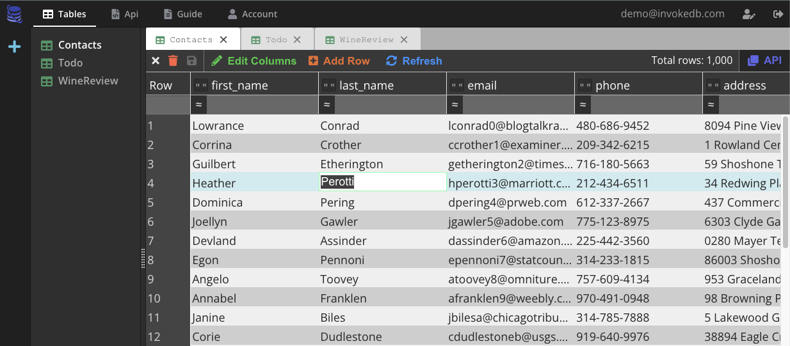
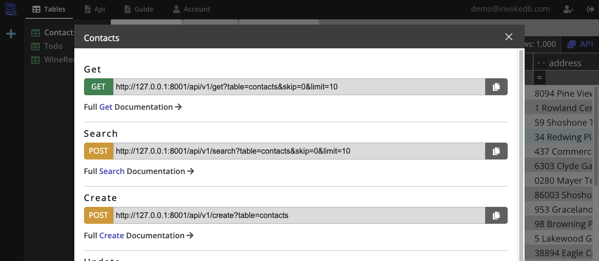

# InvokeDB

A SaaS app for building data tables you can query through an API.

**[invokedb.com](https://invokedb.com)**



Every table gets ready-made API endpoints (get, search, create, update, delete):



Monorepo with two packages:

| Package               | What                                                | Dev URL                          |
| --------------------- | --------------------------------------------------- | -------------------------------- |
| `packages/horizon-be` | NestJS API + websocket server (Postgres + MongoDB)  | http://127.0.0.1:8001 (ws :9000) |
| `packages/horizon-fe` | Frontend (Vue 3): public site at `/`, app at `/app` | http://127.0.0.1:8000            |

Client code lives under `examples/` (each with its own `node_modules`, outside the root formatter):

- `examples/invokedb-node`: the JavaScript/TypeScript API client (npm
  [`invokedb`](https://www.npmjs.com/package/invokedb)), with no dependencies.
- `examples/angular`: an Angular 22 example app (to-do list, contacts, wine reviews) that uses
  the client.
- `examples/data` + `examples/setup.mjs`: made-up example CSVs, and a script that loads them as
  tables into a running InvokeDB. See `examples/README.md`.

## Prerequisites

- Node 22 (`nvm use`)
- PostgreSQL on `127.0.0.1:5432` (Postgres.app or `brew install postgresql`)
- MongoDB on `127.0.0.1:27017` (`brew install mongodb-community`) plus `mongosh`

You don't need Docker, Kubernetes, tmux, or the Stripe CLI for local dev.

## First run

```
npm run setup     # installs all packages, creates .env, creates DBs, runs migrations
npm run dev       # starts the backend + frontend; Ctrl-C stops both
```

Open http://127.0.0.1:8000/login and log in:

```
username: shetzel84@gmail.com   (or demo2@invokedb.com … demo7@invokedb.com)
password: password
```

> **Postgres.app users:** the first time the backend connects, Postgres.app shows a
> permission dialog for `node`. Click **OK**, or the connection fails after 60s.
> You can turn this off in Postgres.app → Settings.

## Config and secrets

All config lives in `.env` at the repo root, created from `.env.example`. Mailgun, Telegram and
Stripe are optional. Without keys, emails and support requests are printed to the backend log.

Secret files (`.env`, `deploy/prod.env`, the Azure `*.values.sh` files, SSH keys) are
gitignored, and the production SSH key lives in `~/.ssh/invokedb`. The originals
live in the Dropbox folder `secret/invokedb`, and you copy them back and forth:

```
npm run secrets:status   # which copies differ
npm run secrets:pull     # Dropbox secret folder -> repo (npm run setup does this)
npm run secrets:push     # repo -> Dropbox secret folder, after editing .env etc.
```

Neither direction overwrites a newer file unless you pass `-- --force`.
Set `INVOKEDB_SECRET_DIR` to use a different folder.

## Database

```
npm run db:setup                    # create missing DBs + run pending migrations (safe)
npm run db:reset                    # drop + recreate InvokeDB's DBs only (Postgres horizon*, Mongo horizon*)
npm run db:demo                     # replace local data with the demo dataset (asks first)
npm run migration:create -- Name    # new TypeORM migration
```

The demo dataset (`ops/shared/dumps/demo`) has three sample tables under `demo@invokedb.com`.

## Formatting

One root prettier 3 config (`.prettierrc.json`) covers the whole repo.

```
npm run format          # format everything
npm run format:check    # check only
```

VS Code formats on save (`.vscode/settings.json`; install the recommended Prettier extension).
It's pointed at the root prettier.

`npm run check` runs what CI runs (builds, lints, unit tests, the examples, shellcheck,
prettier), except the API smoke test. shellcheck is skipped if it isn't installed
(`brew install shellcheck`).

Staged files are also formatted when you commit (`.githooks/pre-commit`). `npm install` at the
root turns this on by setting `git config core.hooksPath .githooks`.

## Work tracking

Work is tracked in GitHub Issues, ordered on the [InvokeDB project board](https://github.com/users/stevehetz/projects/1).
Every change has an issue and goes through a pull request; safe pull requests merge (and
deploy) by themselves. `AGENTS.md`, "How work is tracked", has the details.

## Coding agents

`AGENTS.md` holds the instructions for any coding agent, and `CLAUDE.md` just imports it.
Agent playbooks ("skills") are in `.agents/skills`, and `AGENTS.md` says when to read each one.
`.mcp.json` adds Playwright (browser) and a read-only MongoDB MCP server.

## Versioning

```
npm run push "your commit message"  # bumps the patch version everywhere, commits, tags, pushes
```

## Production (Azure, currently torn down)

`ops/azure-*` and `npm run prod:*` build and deploy to Azure AKS. They aren't used for local
dev and haven't been run since the infrastructure was deleted, so expect to update them
before deploying again.
