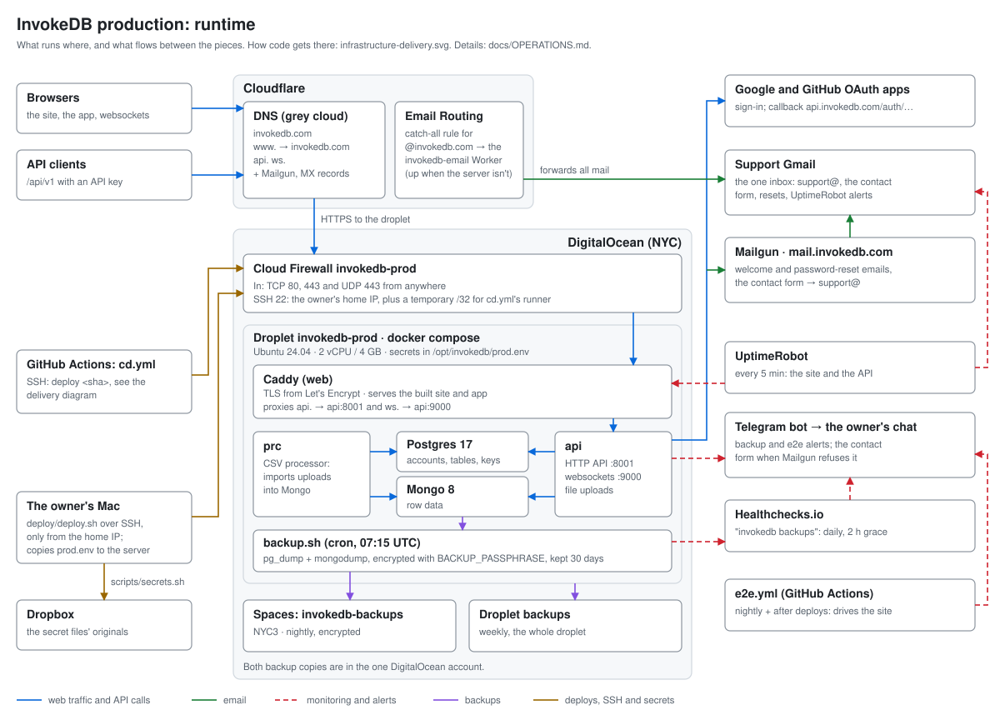
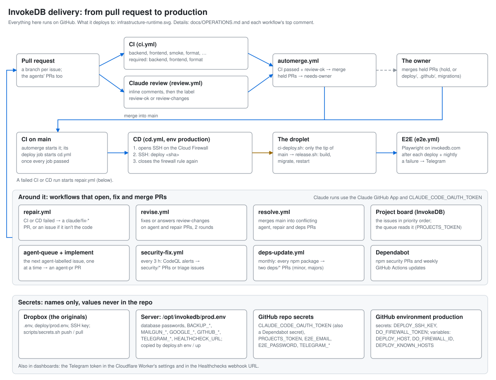

# Operations

_Written 2026-11-24 (issue #15)._

The one place that lists every outside service and automation production depends on: what each
one does, where it's configured, which secrets it uses (names only), who it alerts, and how to
check it works. The details live next to the code; this file links to them instead of copying.

Two diagrams give the picture at a glance (keep them in step with this file):

- [Runtime](images/infrastructure-runtime.svg): DNS, the firewall, the droplet's containers,
  backups, email, sign-in, monitoring and alerts.
- [Delivery](images/infrastructure-delivery.svg): PR → CI + review → auto-merge → CD → E2E,
  the workflows around it, and where the secrets live.

- `deploy/README.md`: the server, deploys, email and backups, step by step.
- `deploy/email-worker/README.md`: inbound email and the Cloudflare Worker.
- The comment at the top of each `.github/workflows/*.yml`: what that workflow does and when.
- `docs/HANDOFF.md`: project state and the history of how this was set up.
- `AGENTS.md`: the rules for working in the repo (PRs, auto-merge, the cloud agent).

**Where secrets live.** Production settings are in `deploy/prod.env` (gitignored; template
`deploy/prod.env.example`), copied to the server as `/opt/invokedb/prod.env` by
`deploy/deploy.sh env` or `up`, and synced to Dropbox with the other secrets by
`npm run secrets:push` / `secrets:pull` (`scripts/secrets.sh`). GitHub secrets are repo
secrets or secrets of the `production` environment. Some values also sit in a third-party
dashboard (Cloudflare, Healthchecks); those are listed below. Never write a value into this
repo: it's public.

## Who gets alerted

| Alert                                                  | Goes to                                                                                      |
| ------------------------------------------------------ | -------------------------------------------------------------------------------------------- |
| Site or API down (UptimeRobot)                         | the support Gmail, by email                                                                  |
| Nightly backup failed or missed (Healthchecks.io)      | Telegram (the contact-form bot)                                                              |
| Contact form                                           | `support@invokedb.com`, so the support Gmail                                                 |
| Contact form when Mailgun refuses the email            | Telegram                                                                                     |
| Any mail to `@invokedb.com`                            | the support Gmail (through the Email Worker)                                                 |
| End-to-end test against production failed (`e2e.yml`)  | Telegram                                                                                     |
| A new error in the API, processor or frontend (#212)   | Telegram (once per error per hour; per process 10 an hour backend, 5 frontend)               |
| CI or CD failed                                        | `repair.yml` pushes a fix (an agent PR's branch), opens a fix PR, or opens an issue (GitHub) |
| PR held (`needs-owner`) or agent stuck (`agent-stuck`) | the owner, by a GitHub mention or label                                                      |

## Monitoring and integrations

### Mailgun (outbound email)

- **Does:** sends the app's emails (welcome, password reset) and the contact-form emails, from
  the domain `mail.invokedb.com` (free plan, US region). Without a key, emails are only written
  to the api container's log.
- **Configured:** the Mailgun dashboard (sending domain); SPF, DKIM and a `p=none`
  `_dmarc.invokedb.com` record in Cloudflare DNS; `prod.env`. The backend reads it in
  `packages/horizon-be/src/env.ts`.
- **Secrets:** `MAILGUN_API_KEY`, `MAILGUN_DN` (`prod.env`). `MAILGUN_SMTP_PASSWORD`
  (`prod.env`, not read by the backend) is the SMTP login the support Gmail uses to send as
  `support@invokedb.com`.
- **Alerts:** none of its own. A refused contact-form email falls back to Telegram.
- **Check:** request a password reset for a `demo*@invokedb.com` account and see it arrive in
  the support Gmail; or `deploy/deploy.sh logs api` for send errors. Mailgun's dashboard has
  the delivery log and the monthly quota (3,000 on the free plan).
- **Details:** `deploy/README.md` "Day to day"; HANDOFF step 5, items 3 and 4.

### Anthropic API (AI features)

- **Does:** answers "ask your data" questions on a table (#149): Claude turns a question into a
  read-only `/api/v1/query` body, which the backend checks and runs. Off without a key and a
  budget: the grid's Ask button is hidden and `/ai/*` answers 503.
- **Configured:** `ANTHROPIC_API_KEY` and `HORIZON_AI_MONTHLY_BUDGET_USD` (what the whole
  server may spend per UTC month) in the backend's env; `HORIZON_AI_MODEL` optionally overrides
  the model (default `claude-haiku-5-5`, in `packages/horizon-be/src/core/ai/ai-plan.ts`). In
  production they also have to be passed to the backend in `deploy/compose.yaml` (#187).
- **Account:** the Anthropic Console, workspace `InvokeDB`; its monthly spend limit is the
  last backstop, so keep it a little above `HORIZON_AI_MONTHLY_BUDGET_USD`.
- **Secrets:** `ANTHROPIC_API_KEY` (`prod.env`).
- **Limits** (`docs/PRICING.md` 3.5, `core/ai/ai-plan.ts`): per account and UTC month, a count
  of questions and a dollar budget by tier (nothing for unverified accounts), and the
  server-wide budget. Usage, tokens and cost are in the tracking DB's `tracking:ai_usage` (per
  account) and `tracking:ai_server_usage` (per month).
- **Alerts:** Telegram when the month's spending passes 50%, 80% and 100% of the server budget;
  at 100% the AI features pause until the 1st (UTC). Failed calls are logged (`ai ask failed`)
  and the user sees a 502.
- **Check:** open a table, click Ask, ask "how many rows are there?".

### Stripe (billing, #129)

- **Does:** sells Starter and Pro (`docs/PRICING.md` 3.2), monthly or yearly. The Account page's
  buttons open **Stripe Checkout**; **Manage billing** opens the **Customer Portal** (change
  plan, cancel, card, invoices). The plan on the account only ever comes from the signed webhook
  `POST https://<API_DOMAIN>/billing/webhook`: each event makes the backend read the customer's
  subscriptions from Stripe and set the plan from them (`application/billing/billing.service.ts`,
  rules in `core/billing/billing.ts`). A failed payment keeps the plan in the 14-day grace
  period (#184); when it ends the account goes to Free and its subscription is cancelled.
  Deleting an account cancels its subscription first. Free accounts have no Stripe customer.
- **Configured:** `STRIPE_SECRET_KEY` and `STRIPE_WEBHOOK_SECRET` in the backend's env (passed
  in `deploy/compose.yaml`). Without both, billing is off: no buttons, `/billing/*` answers 503.
  The four prices are found by their **lookup keys**, so no price id is configured:
  `invokedb_starter_month`, `invokedb_starter_year`, `invokedb_pro_month`, `invokedb_pro_year`
  (`PRICE_LOOKUP_KEYS`). The amounts shown in the app come from `core/plan/plans.ts`; keep
  Stripe's prices the same.
- **Account:** dashboard.stripe.com (test mode locally, live mode in production).
- **Secrets:** `STRIPE_SECRET_KEY`, `STRIPE_WEBHOOK_SECRET` (`prod.env`; locally `.env`).
- **Set up (once per mode, test then live):**
  1. **Product catalog → Add product** "InvokeDB Starter" with two recurring prices, $9/month
     and $90/year; under each price's **Advanced → Lookup key**, `invokedb_starter_month` and
     `invokedb_starter_year`. The same for "InvokeDB Pro": $29/month (`invokedb_pro_month`),
     $290/year (`invokedb_pro_year`).
  2. **Settings → Billing → Customer portal:** turn on cancelling (at the end of the period),
     updating the payment method, invoice history and **switching plans** between the four
     prices (downgrades at the end of the period).
  3. **Settings → Billing → Subscriptions and emails → Manage failed payments:** retry for up to
     2 weeks, then **cancel the subscription** (matches the 14-day grace period).
  4. **Developers → Webhooks → Add endpoint:** `https://<API_DOMAIN>/billing/webhook`, events
     `checkout.session.completed`, `customer.subscription.created`, `.updated`, `.deleted`,
     `.paused`, `.resumed`, `invoice.paid`, `invoice.payment_failed`. Its signing secret is
     `STRIPE_WEBHOOK_SECRET`.
  5. **Developers → API keys:** the secret key is `STRIPE_SECRET_KEY`.
  6. Locally: `stripe listen --forward-to 127.0.0.1:8001/billing/webhook` instead of step 4,
     and use the `whsec_` it prints.
- **Alerts:** none of its own. A webhook that fails answers 500 and Stripe retries it for 3
  days (Developers → Webhooks shows failures, and Stripe emails the account owner). A Stripe
  price missing its lookup key is logged (`Stripe has no active price with the lookup key`).
- **Check:** in test mode, Account → Get Starter → card `4242 4242 4242 4242` → back on the
  Account page the plan reads Starter within seconds; Manage billing opens the Portal.

### Telegram bot

- **Does:** one bot posts to one chat (the owner's). The backend uses it as the fallback for
  contact-form requests when Mailgun refuses them, for the AI budget alerts and for new errors
  (#212, "Error tracking" below); Healthchecks.io posts backup alerts through it; the Email Worker can post alert notices through it (unused today, see below).
- **Configured:** created with `@BotFather` (steps in `deploy/README.md` "Day to day"). The same
  token is stored in three places: `prod.env`, the Worker's settings and the Healthchecks
  webhook URL.
- **Secrets:** `TELEGRAM_BOT_TOKEN`, `TELEGRAM_CHAT_ID`. If the token is ever revoked, update
  all three places.
- **Alerts:** the owner's Telegram chat.
- **Check:** Healthchecks.io → the check → Integrations → test the webhook; a message should
  arrive in the chat.

### Google and GitHub sign-in (OAuth apps)

- **Does:** "Continue with Google / GitHub" on the login and signup pages (#17). A provider's
  button only shows when its client ID and secret are both set. A login links to an existing
  account only by an email the provider says is verified, and never to an account that has a
  password (signup doesn't verify emails, so the password's owner may not own the mailbox).
- **Configured:** a Google OAuth client (Google Cloud console, APIs & Services → Credentials,
  "Web application") and a GitHub OAuth App (github.com/settings/developers). Each lists its
  callback URL: `https://api.invokedb.com/auth/<google|github>/callback` in production, and
  `http://127.0.0.1:8001/auth/<google|github>/callback` for local dev (GitHub allows one
  callback per app, so use a second app for local). The backend reads them in
  `packages/horizon-be/src/env.ts`; the flow is in `src/web/http/auth/sso.controller.ts`.
- **Secrets:** `GOOGLE_CLIENT_ID`, `GOOGLE_CLIENT_SECRET`, `GITHUB_CLIENT_ID`,
  `GITHUB_CLIENT_SECRET` (`prod.env`, and `.env` locally).
- **Alerts:** none. Failed sign-ins are logged by the api container (`SSO sign-in …`).
- **Check:** `https://api.invokedb.com/auth/sso-providers` shows which are on; then sign in
  with each on `https://invokedb.com/login`.

### UptimeRobot (uptime)

- **Does:** checks `https://invokedb.com` and `https://api.invokedb.com/auth/authorize` every 5
  minutes (free plan). The API check answers 200 without touching the databases, so it
  catches a down server or container, not a database outage.
- **Configured:** the UptimeRobot dashboard. Nothing in the repo.
- **Secrets:** none in the repo. Its login is the support Gmail.
- **Alerts:** email to the account's login address, the support Gmail (the free plan can't
  email anyone else or send to Telegram).
- **Check:** both monitors show "Up" in the dashboard.
- **Details:** HANDOFF step 5, item 2.

### Healthchecks.io (backup heartbeat)

- **Does:** the check "invokedb backups" (period 1 day, grace 2 hours) expects a ping from
  every nightly backup; `deploy/backup.sh` pings `/start`, then success or `/fail` with the
  end of its log.
- **Configured:** the Healthchecks.io dashboard (the check, and a webhook integration that
  calls the Telegram bot's `sendMessage`; email alerts are off). The ping URL is in
  `prod.env`.
- **Secrets:** `HEALTHCHECK_URL` (`prod.env`); the bot token inside the webhook URL.
- **Alerts:** Telegram, when a backup fails or doesn't report within a day plus grace.
- **Check:** the dashboard shows the last ping within a day, with the backup's log as its body;
  or `deploy/deploy.sh backup run` and watch it ping.
- **Details:** `deploy/README.md` "Backups".

### Cloudflare DNS and the domain

- **Does:** `invokedb.com` was bought on Cloudflare Registrar, so its DNS is there. A records
  `@`, `www`, `api` and `ws` point at the droplet, **DNS-only** (grey cloud) so Caddy gets its
  Let's Encrypt certificates directly. It also holds the Mailgun records (above) and Email
  Routing's MX and SPF records on the root domain.
- **Configured:** the Cloudflare dashboard. The hostnames are `SITE_DOMAIN`, `API_DOMAIN` and
  `WS_DOMAIN` in `prod.env`; Caddy uses `ACME_EMAIL` for Let's Encrypt.
- **Secrets:** none.
- **Alerts:** none (UptimeRobot notices if the site stops resolving).
- **Check:** `dig +short invokedb.com api.invokedb.com ws.invokedb.com` gives the droplet's IP;
  the site loads over HTTPS.
- **Details:** `deploy/README.md` "First deployment"; HANDOFF step 5a (turning on the
  Cloudflare proxy would need SSL set to Full (strict)).

### Cloudflare Email Routing and the `invokedb-email` Worker (inbound email)

- **Does:** every message to any `@invokedb.com` address goes, by the catch-all rule, to the
  Email Worker `invokedb-email`, which forwards it to the support Gmail (`FORWARD_TO`). The
  `uptime@` address (`TELEGRAM_ONLY_RECIPIENTS`) is never forwarded: alert-service mail to it
  becomes a Telegram notice and anything else is dropped. Nothing sends to `uptime@` today. It
  runs on Cloudflare, so it keeps working when the server is down.
- **Configured:** the code is `deploy/email-worker/worker.js`, pasted into the Cloudflare
  dashboard by hand (not deployed by CI). Routing rules and settings are in the dashboard.
- **Secrets:** Worker secret `TELEGRAM_BOT_TOKEN`; text settings `TELEGRAM_CHAT_ID`,
  `FORWARD_TO`, `ALERT_SENDER_DOMAINS`, `NOTIFY_RECIPIENTS` (empty),
  `TELEGRAM_ONLY_RECIPIENTS`.
- **Alerts:** the support Gmail (forwards); Telegram (notices, unused today).
- **Check:** send a message from an outside mailbox to `support@invokedb.com`; it reaches the
  support Gmail with no Telegram notice. The Worker's Logs tab shows each message.
- **Details:** `deploy/email-worker/README.md` (setup, settings, tests).

### The support Gmail

- **Does:** `invokedbsupport@gmail.com` is the one inbox for everything: `support@`, the
  contact form, `demo*@` password resets, UptimeRobot alerts, any other `@invokedb.com` mail.
  Nothing goes to the owner's personal Gmail. It can reply **as** `support@invokedb.com`
  ("Send mail as", through `smtp.mailgun.org:587` with the Mailgun SMTP login
  `support@mail.invokedb.com`).
- **Configured:** Gmail settings; it's the verified destination address in Email Routing and the
  UptimeRobot login.
- **Secrets:** its own Google login; `MAILGUN_SMTP_PASSWORD` for "Send mail as".
- **Check:** the Email Routing test above; reply to a contact-form email and check the sender
  is `support@invokedb.com`.
- **Details:** HANDOFF step 5, item 4 (the routing table).

## Delivery

### CI (`.github/workflows/ci.yml`)

- **Does:** on every PR push and every push to `main`: backend build + lint + unit tests
  (`backend`), the API smoke test against the built backend with Postgres and Mongo service
  containers (`smoke`), frontend build (failing on Sass deprecation warnings) + lint
  (`frontend`), and `prettier --check` (`format`). On a CI run that `automerge.yml` started on
  `main`, the `deploy` job starts `cd.yml` once everything passed.
- **Secrets:** none.
- **Alerts:** a failure starts `repair.yml`; GitHub shows it on the PR.
- **Check:** the PR's checks, or the Actions tab.

### CD (`.github/workflows/cd.yml`)

- **Does:** deploys `main` to production after CI passed on it. It opens SSH on the
  DigitalOcean Cloud Firewall to the runner's IP, sends `deploy <sha>` over SSH, then closes
  the rule again. On the server, the key can only run `deploy/ci-deploy.sh`, which deploys the
  commit only if it's still the tip of `main` (or the tip, if only Markdown changed after it),
  downloads it from GitHub and runs
  `deploy/release.sh` (build, migrate, restart). Code only: `prod.env` isn't touched.
- **Configured:** the GitHub environment `production` (deployment branches limited to `main`);
  `deploy/deploy.sh install-ci` installs the key on the server.
- **Secrets:** environment secrets `DEPLOY_SSH_KEY`, `DO_FIREWALL_TOKEN` (a DigitalOcean API
  token with `firewall:read` and `firewall:update` only); environment variables `DEPLOY_HOST`,
  `DO_FIREWALL_ID`, `DEPLOY_KNOWN_HOSTS`.
- **Alerts:** a failure starts `repair.yml`, which opens an issue when the cause isn't in the
  code (e.g. the server was unreachable).
- **Check:** the run in the Actions tab ends green, and `/opt/invokedb/app/REVISION` on the
  server (`deploy/deploy.sh ssh`) holds the deployed commit. If the close step ever fails,
  delete the leftover `/32` SSH rule on the firewall by hand.
- **Details:** `deploy/README.md` "Automatic deploys".

### End-to-end test (`.github/workflows/e2e.yml`)

- **Does:** drives `https://invokedb.com` in Playwright's Chromium as a dedicated test account
  with `scripts/ui-smoke.mjs`: the public pages, login, a CSV upload (progress over the
  websocket), sort, filter, a cell edit, column changes, making an API key and calling
  `/api/v1` with it (it revokes the keys it made), deleting the table, logout. It deletes any table it left behind, even when a step fails. It doesn't sign up
  or use Google/GitHub sign-in.
- **Runs:** nightly at 06:00 UTC, by hand ("Run workflow"), and after every successful deploy
  (`cd.yml` starts it with the deployed commit).
- **Secrets:** repo secrets `E2E_EMAIL`, `E2E_PASSWORD` (the test account, `e2e@invokedb.com`;
  its mail lands in the support Gmail), `TELEGRAM_BOT_TOKEN`, `TELEGRAM_CHAT_ID` (the
  contact-form bot).
- **Repair:** a failure on `main` also starts `repair.yml` with the run's id, unless an open
  "Fix E2E" PR or "E2E failed" issue already covers it; Claude decides whether the app or the
  test is wrong and opens a fix PR (which auto-merges like any other) or an issue (#198).
- **Alerts:** a failure sends a Telegram message naming the trigger (and the commit, after a
  deploy) and keeps the failing step's screenshot (password and API key masked) as the run's `e2e`
  artifact (14 days). No trace: artifacts on this public repo can be downloaded by anyone, and a
  trace holds the credentials. To dig in, run it locally with `--trace` (see `ui-smoke.mjs`).
- **Check:** the Actions tab shows a green run each night; `gh run list -w e2e.yml`.

### Claude review, repair, auto-merge and the cloud agent

All Claude runs authenticate through the Claude GitHub App with the repo secret
`CLAUDE_CODE_OAUTH_TOKEN` (from `claude setup-token`, on the owner's subscription). The action
only runs a workflow file identical to `main`'s, so a PR that changes a workflow isn't handled
by its own new version. Each file's top comment explains it; AGENTS.md "Hard rules" and
"The cloud agent" give the rules.

| Workflow           | Does                                                                                                                                  | Alerts / output                                     |
| ------------------ | ------------------------------------------------------------------------------------------------------------------------------------- | --------------------------------------------------- |
| `review.yml`       | Reviews every same-repo PR, inline comments, labels it `review-ok` or `review-changes`                                                | Labels and comments on the PR                       |
| `repair.yml`       | On a failed CI or CD run, pushes a fix onto an agent PR's branch (#135), or opens a `claude/fix-*` PR, or an issue with its diagnosis | A PR or issue                                       |
| `automerge.yml`    | Merges PRs into `main` that passed CI and got `review-ok`, unless `hold` or a held path; starts CI on `main` after                    | `needs-owner` on held PRs                           |
| `revise.yml`       | Fixes or answers `review-changes` comments on agent and repair PRs (2 rounds max)                                                     | `agent-stuck` and a mention of the owner after that |
| `resolve.yml`      | Merges `main` into conflicting agent and repair PRs and resolves the conflicts                                                        | `agent-stuck` and a mention if it can't             |
| `agent-queue.yml`  | Starts `implement.yml` on the next `agent`-labelled issue, one at a time                                                              | `agent-stuck` and a mention on a stuck PR           |
| `implement.yml`    | The cloud agent: works one issue and opens an `agent-pr` PR                                                                           | The PR                                              |
| `security-fix.yml` | Every 3 hours and by hand: fixes up to 3 alerts in `security/*` PRs, dismisses false positives, or files triage issues                | The PRs and issues                                  |
| `deps-update.yml`  | Monthly (1st, 09:00 UTC) and by hand: updates every npm package, opens a minor/patch PR and a majors PR (`deps/*`)                    | The PRs; skipped majors listed with reasons         |

- **Secrets:** `CLAUDE_CODE_OAUTH_TOKEN` (also saved as a Dependabot secret, so the review runs on
  Dependabot PRs); `PROJECTS_TOKEN` (a classic token with the `project` scope: the queue reads the board's order with it, and the agent workflows add the issues they file to the board).
- **Dependencies:** `deps-update.yml` does routine npm updates monthly, following
  `docs/DEPENDENCY_PINS.md`. Dependabot (`.github/dependabot.yml`) only opens npm **security** PRs
  (Dependabot alerts and security updates are on in the repo settings) and weekly GitHub Actions
  updates. Also on: CodeQL code scanning (default setup), private vulnerability reporting, secret
  scanning with push protection; `SECURITY.md` says how to report a vulnerability.
- **Check:** a PR gets a review comment and a `review-ok`/`review-changes` label within a few
  minutes; the Actions tab shows each workflow's runs. `revise.yml` and `resolve.yml` run on the
  owner's own PRs only with the `agent-fix` label.

### The `main` ruleset

- **Does:** every change reaches `main` through a PR, and the required CI checks must pass.
  Nobody (people or workflows) pushes to `main` directly.
- **Configured:** GitHub repo Settings → Rules → Rulesets.
- **Required checks:** `backend`, `frontend`, `format` (see HANDOFF "Things to know"). A
  dispatched CI run doesn't count toward them (#40).
- **Check:** a PR whose checks haven't passed shows "Merging is blocked".

### The DigitalOcean droplet

- **Does:** runs all of production with `docker compose`: Caddy (TLS + the built frontend),
  the API, the CSV processor, Postgres 17 and Mongo 8. Droplet `invokedb-prod`, Basic
  2 vCPU / 4 GB, Ubuntu 24.04, NYC.
- **Configured:** `deploy/` (`compose.yaml`, `Caddyfile`, the Dockerfiles), driven from the
  Mac by `deploy/deploy.sh`; settings in `/opt/invokedb/prod.env`.
- **Secrets:** `DEPLOY_HOST`, `DEPLOY_SSH_KEY` (the path to `~/.ssh/invokedb`, synced to
  Dropbox), `POSTGRES_PASSWORD`, `MONGO_ROOT_PASSWORD`, `MONGO_APP_PASSWORD`,
  `HORIZON_WS_SERVER_TOKEN`, `ACME_EMAIL` (all `prod.env`).
- **Alerts:** UptimeRobot.
- **Check:** `deploy/deploy.sh ps` and `deploy/deploy.sh logs [api|prc|web|postgres|mongo]`.
- **Details:** `deploy/README.md`.

### The Cloud Firewall

- **Does:** the firewall `invokedb-prod` lets in TCP 80 and 443 and UDP 443 from anywhere, and
  SSH (TCP 22) only from the owner's home IP. `cd.yml` adds a temporary `/32` SSH rule for its
  runner during a deploy.
- **Configured:** the DigitalOcean dashboard (Networking → Firewalls).
- **Secrets:** `DO_FIREWALL_TOKEN` and `DO_FIREWALL_ID` (GitHub `production` environment).
- **Check:** if SSH from the Mac times out, the home IP has probably changed: update the SSH
  rule, or use the droplet's Web Console. After a deploy, no `/32` runner rule is left behind.

### Spaces backups (off-site, nightly)

- **Does:** `deploy/backup.sh` runs from cron at 07:15 UTC on the server: `pg_dump` and
  `mongodump`, encrypted with `BACKUP_PASSPHRASE`, uploaded to the Spaces bucket
  `invokedb-backups` (NYC3) under a timestamp folder; backups over 30 days old are deleted after
  each successful run. Uploaded CSV files aren't backed up (they're temporary).
- **Configured:** the bucket and its limited-access key in DigitalOcean; the cron job by
  `deploy/deploy.sh backup install`; settings in `prod.env`.
- **Secrets:** `BACKUP_PASSPHRASE` (without it the backups can't be read; keep the Dropbox copy
  of `prod.env`), `BACKUP_S3_ENDPOINT`, `BACKUP_S3_BUCKET`, `BACKUP_S3_KEY_ID`,
  `BACKUP_S3_SECRET`, `BACKUP_KEEP_DAYS`, `HEALTHCHECK_URL`.
- **Alerts:** Healthchecks.io → Telegram.
- **Check:** `deploy/deploy.sh backup list` shows last night's backup, and
  `deploy/deploy.sh backup verify` restores the latest into throwaway containers and prints
  its counts beside the live ones (run it monthly). The log is `/var/log/invokedb-backup.log` on the server.
- **Details:** `deploy/README.md` "Backups" (setup, restore, a new server).

### Droplet backups (weekly)

- **Does:** DigitalOcean's weekly backup of the whole droplet, a second copy. Both copies are in
  the same DigitalOcean account, so losing the account loses both; a second provider (e.g.
  Backblaze B2 with the same script) is a later option.
- **Configured:** the droplet's Backups tab in DigitalOcean. Nothing in the repo.
- **Secrets:** none.
- **Alerts:** none.
- **Check:** the droplet's Backups tab lists a backup from the last week.

### Onboarding funnel (#169)

- **Does:** prints how many accounts that signed up reach each onboarding step (verified the
  email, made a table, viewed the API key, copied the command, called the API), with the median
  time from signup to each, above all to the first API call. Read-only: it reads the onboarding
  documents in the tracking Mongo database. Accounts made before #169 have no signup time and
  are left out (counted at the bottom).
- **Configured:** nothing; `src/cli/onboarding-funnel.ts` in the backend.
- **Secrets:** none beyond the backend's Mongo settings.
- **Check:** in production,
  `deploy/deploy.sh compose exec -T api node dist/cli/onboarding-funnel.js --days 30` (or
  `--since 2026-12-01 --until 2027-01-01`, UTC days, `until` excluded; `--json` for JSON).
  Locally, `npm run onboarding:funnel -- --days 30`.

### Admin area (#277)

- **Does:** `/app/admin` in the app (the account menu's **Admin**): an overview (sign-ups per day,
  active accounts, accounts per plan, tables, rows, storage, API calls and AI spend this month
  against `HORIZON_AI_MONTHLY_BUDGET_USD`, the latest production E2E run), the accounts list
  (search, sort, paging, over/near-cap filter) and each account's page (its numbers, tables by
  name and size, API key prefixes, recent history, AI use) with actions: change the plan (Free,
  Starter, Pro or internal), lock/unlock, resend the verification email, reset two-factor, delete.
  Each action is confirmed and recorded in that account's history with the admin as the actor.
  No rows, no impersonation. The numbers are a snapshot read again every 3 minutes (the E2E
  result every 5, from GitHub's public API). Accounts made before #277 have no sign-up date.
- **Become an admin:** add your email to `HORIZON_ADMIN_EMAILS` in `deploy/prod.env`
  (comma-separated), `npm run secrets:push`, then `deploy/deploy.sh up` so the api
  container gets it. The account also needs a verified email and a second factor: two-factor
  sign-in on (Account page; needs `HORIZON_TOTP_KEY`) for a password account, while an account
  with no password (Google/GitHub sign-in only) passes, since the provider holds its second
  factor: turn on 2-Step Verification there (#288). Reload the app and **Admin** shows in the
  account menu. Anyone else, an API key, or a password admin without two-factor gets 404 from
  every `/admin` route.
- **Configured:** `HORIZON_ADMIN_EMAILS` (`deploy/compose.yaml` passes it to the api container).
- **Secrets:** none; it's a list of emails, kept in `prod.env` with the rest.
- **Alerts:** none. Each action is also logged (`Admin <id> on account <id>: ...`) by the api.
- **Check:** the account menu shows **Admin** and the overview loads. Locally: set
  `HORIZON_ADMIN_EMAILS` in `.env`, turn on two-factor for that account, restart the backend.

### Error tracking (#212)

- **Does:** keeps the unhandled errors of the API (any 5xx but 503, from `AllExceptionFilter`),
  the processor (a job or the URL sync scheduler that threw) and both (an uncaught exception or
  unhandled rejection, which is recorded and then still ends the process, so Docker restarts it),
  plus the frontend's (window `error`, `unhandledrejection`, Vue's `errorHandler`; posted to the
  public `POST /errors`, at most 10 per page load and each error once; the backend allows 10 per
  page session and 30 per IP per 10 minutes). Self-hosted: no outside service. Each error is
  stored in the tracking DB's `tracking:error`, grouped by a fingerprint (source, the message
  without its numbers and ids, the top stack frame), with a count, first and last seen and the
  latest occurrence: message, stack, route pattern (`GET /web-file/:id`) or page path, status,
  account id, browser. Never request bodies, headers or query strings; messages and stacks are
  scrubbed of emails, tokens, keys and URL credentials. Kept 30 days after it was last seen (a
  TTL index); past 3,000 backend (API and processor) errors or 2,000 frontend ones, new ones of
  that kind stop being stored (separate caps, so the public frontend reports can't crowd out the
  backend's). Code:
  `packages/horizon-be/src/core/error-tracking/`, `packages/horizon-fe/src/core/error-report.js`.
- **Where to look:** the admin area's **Errors** tab (`/app/admin`, admins only): the list, last
  seen first, filtered by source; an error's page has its latest stack. A frontend stack is shown
  in the source files: the build writes hidden source maps next to the assets
  (`vite.config.js`), and the page reads them from the site.
- **Configured:** nothing beyond the Telegram bot.
- **Secrets:** `TELEGRAM_BOT_TOKEN`, `TELEGRAM_CHAT_ID` (`prod.env`), as for the other alerts.
  No new ones.
- **Alerts:** Telegram, when an error's fingerprint is new: at most one message per fingerprint
  per hour, and per process at most 10 an hour for api/processor errors and 5 for frontend ones
  (separate budgets, so anonymous frontend reports can't use up the backend's), with a link to
  the error's page. Without the Telegram settings, errors are still stored, just not sent.
- **Check:** the Errors tab loads. The API smoke test posts a frontend error and reads it back
  as the admin.

### Status page (#212)

- **Does:** `https://invokedb.com/status` (linked from the site's footer) shows our own checks,
  answered by the API at `GET /status` (public, cached 30 seconds): the API itself (its
  websocket client is registered, as `/health`), a round trip to Postgres and to Mongo (degraded
  over 1 s, down on failure or after 5 s), the job processor's heartbeat (the `prc` container
  writes one to `tracking:status` every 30 s; degraded after 2 minutes, down after 10) and the
  latest production E2E run (from GitHub's public API, as on the admin overview; unknown when
  older than 3 days). The headline is an outage when the API or a database is down, degraded
  when anything else is. If the API can't be reached at all, the page says so itself. No
  outside host.
- **Incident note:** the admin area's **Status** tab sets a note (Notice, Degraded or Outage)
  shown at the top of the page until it's removed; Degraded and Outage also set the headline.
- **Configured:** nothing. **Secrets:** none.
- **Alerts:** none of its own: UptimeRobot, the E2E test and error tracking alert.
- **Check:** the page shows every check as Operational; `curl https://api.invokedb.com/status`.
